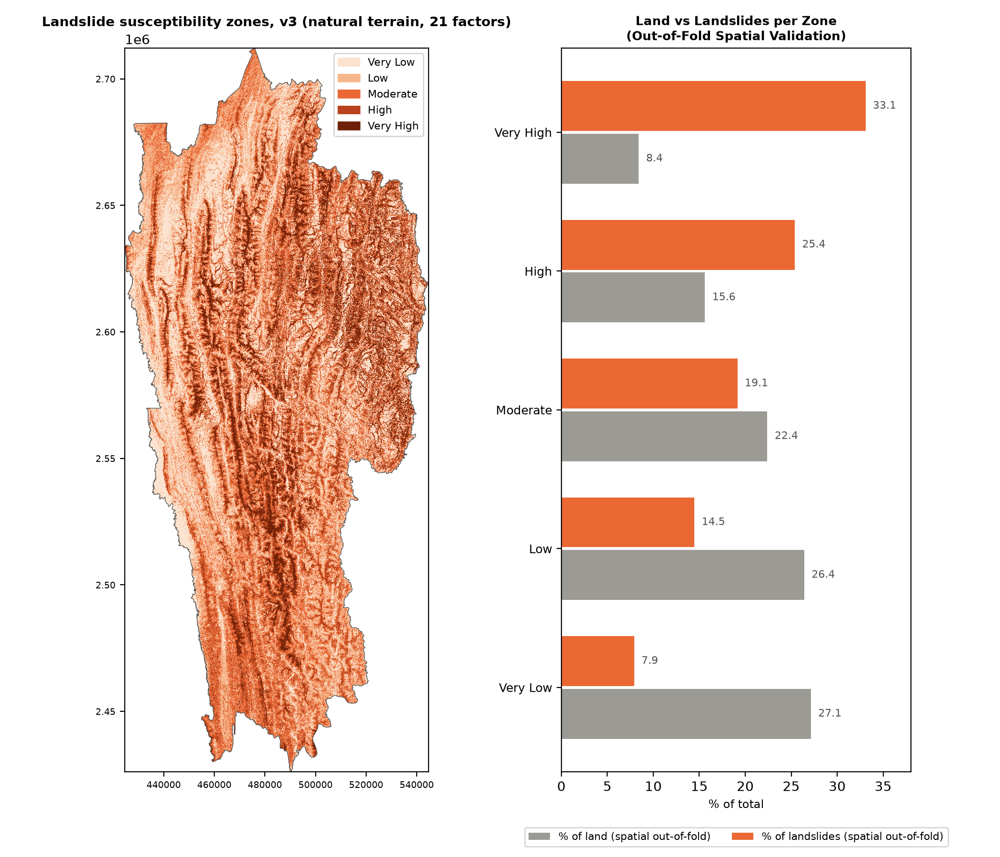

# Landslide Susceptibility Mapping of Mizoram with Machine Learning

**B.Tech Final-Year Project · Computer Science & Engineering · NIT Mizoram**


A state-wide machine-learning model that ranks every 30 m cell of Mizoram, India, by **relative
landslide susceptibility**. It is built only from open data and reproducible Python scripts, and it
is validated with **10 km spatial blocks**, so the scores measure prediction in *new places*, not
gap-filling between neighbouring pixels.



*Recommended map (natural-terrain v3). Out-of-fold spatial validation: the Very High zone covers
8.4 % of the land but contains 33.1 % of held-out landslides.*

---

## Highlights

| | |
|---|---|
| **Study area** | Mizoram, 21,051 km² of land; 30.3 m grid (EPSG:32646), 9,437 × 3,959 cells, **22,918,792 land cells** |
| **Data** | 10 open sources: Copernicus DEM, GSI landslide inventory, NASA COOLR, GSI/NGDR, OpenStreetMap, SoilGrids, CHIRPS rainfall, GEM faults, ESA WorldCover, Sentinel-2 |
| **Samples** | **1,859 landslide pixels** (one pixel per landslide) and matched non-landslide sets |
| **Features** | **25 conditioning factors**: slope, aspect, curvature, TPI, relief, TWI, SPI, HAND (D-infinity flow routing), soil, rainfall, roads, rivers, faults, land cover |
| **Models** | Logistic Regression, SVM, Random Forest, XGBoost, LightGBM and an ensemble, tuned with **Optuna** inside **nested 10 km spatial-block CV** |
| **Best CV score** | XGBoost **ROC-AUC 0.945** (95 % CI 0.933 to 0.955), macro-F1 0.878 |
| **Key finding** | An audit showed an earlier ROC-AUC of **0.893 was spatial leakage** (true score under spatial blocks: 0.68), and that road proximity explains most of the all-factor score |
| **Final map** | **Natural-terrain XGBoost (21 factors, no road or land-cover factors)**: AUC 0.692 to 0.788 on landslides it never saw |

## Research question

> **What is the landslide susceptibility of Mizoram?**

The answer is a map of *relative* susceptibility (scores from 0 to 1, grouped into five zones). It is
not a probability of failure and not a forecast of when a landslide will happen.

## Results

### Model comparison (nested 10 km spatial CV, all 25 factors)

| Model | ROC-AUC | PR-AUC | Macro-F1 | MCC |
|---|---|---|---|---|
| XGBoost | **0.945** | 0.949 | 0.878 | 0.755 |
| LightGBM | 0.945 | 0.949 | 0.878 | 0.756 |
| Ensemble (RF + XGB + LGBM) | 0.945 | 0.949 | 0.876 | 0.753 |
| Random Forest (tuned) | 0.944 | 0.948 | 0.883 | 0.766 |
| SVM, RBF (tuned) | 0.910 | 0.899 | 0.842 | 0.688 |
| Logistic Regression (tuned) | 0.892 | 0.869 | 0.828 | 0.658 |
| *Baseline: distance to a road alone* | *0.912* | | *0.839* | *0.682* |

The tree models tie. Most of their score is what road distance alone already gives, because
**76 % of recorded landslides lie within 60 m of a road** (against 6 % of the land). Roads may cause
failures, and surveys were also carried out along roads; these data cannot separate the two.

### Testing the maps on landslides they never saw

| Map | Held-out GSI landslides | Unseen mapped polygons (1,434 px) | Unused polygons outside training sheets (1,045 px) | Records from 2024 onward (708 px) |
|---|---|---|---|---|
| **Natural-terrain map v3 (recommended)** | 0.734 | **0.692** | 0.692 | 0.788 |
| All-factor map v3 | 0.943 | 0.554 | 0.646 | 0.916 |
| Distance to a road alone | 0.919 | 0.429 | 0.649 | 0.930 |

Away from roads the all-factor map drops to 0.554, while the natural-terrain map holds up. That is
why the natural-terrain map is the main result.

### Susceptibility zones (natural-terrain v3, held-out GSI landslides)

| Zone | % of land | % of landslides |
|---|---|---|
| Very High | 8.4 | 33.1 |
| High | 15.6 | 25.4 |
| Moderate | 22.4 | 19.2 |
| Low | 26.4 | 14.5 |
| Very Low | 27.1 | 7.9 |

### What drives the natural model

Permutation importance on road-matched, held-out tests: **slope** (0.093), mean annual rainfall
(0.021), profile curvature (0.013), TWI (0.012). Steeper and wetter ground ranks higher. This is an
association, not proof of cause. GSI 1:50,000 geology was tested and **added nothing**
(0.7014 vs 0.702, where +0.010 was required).

## Method

```mermaid
flowchart LR
    A["Open data<br/>DEM · inventory · rainfall<br/>soil · OSM · land cover"] --> B["30 m master grid<br/>EPSG:32646, land mask,<br/>10 km DEM margin"]
    B --> C["Feature engineering<br/>25 terrain, hydrology,<br/>soil and access factors"]
    C --> D["Sampling<br/>1 pixel per landslide,<br/>buffered negatives"]
    D --> E["Modelling<br/>6 algorithms, Optuna,<br/>nested 10 km block CV"]
    E --> F["Controls<br/>road-only baseline,<br/>coordinates-only model"]
    F --> G["Independent tests<br/>unseen polygons,<br/>2024+ records"]
    G --> H["State-wide map<br/>22.9M cells,<br/>5 zones (natural breaks)"]
```



**Leakage prevention:** one pixel per landslide; 10 km spatial blocks (`StratifiedGroupKFold`,
median distance from a test landslide to the nearest training landslide: 3,738 m); tuning,
thresholds, imputation and scaling done inside training folds; feature choices made without labels;
a coordinates-only control beside every main score; decision rules fixed before testing; results
repeated over 10 block assignments (SD 0.001 to 0.005).

### Project phases

| Phase | What was done | Outcome |
|---|---|---|
| 1 | First model from 41 NASA COOLR landslide pixels | Too few, imprecise points |
| 2 | Added GSI records; random 5-fold CV | ROC-AUC 0.893, later shown to be **spatial leakage** (0.68 under 10 km blocks; coordinates alone: 0.896) |
| 3 | Rebuilt pipeline: one pixel per landslide, spatial CV, flow routing, roads, rivers, soil | All-factor and **natural-terrain v3 maps** |
| 4 | Tested GSI 1:50,000 geology; independent test on unseen GSI landslides | Geology rejected; natural v3 carries over best |
| 5 | Retrained with mapped polygons (v5) | Gain shown to be inflated by location and aspect bias; **v5 not recommended** |

## Data sources

| Data | Provider | Used for |
|---|---|---|
| Copernicus DEM GLO-30 | ESA (AWS Open Data) | Terrain and hydrology |
| GSI landslide inventory | Geological Survey of India (BharAtlas mirror) | Training landslides |
| NASA COOLR | NASA GSFC | First model; 2 exact points kept |
| GSI data from NGDR | GSI, geodataindia.gov.in | Geology test; landslides for testing |
| OpenStreetMap | Geofabrik extract | Roads and rivers |
| SoilGrids 2.0 | ISRIC | Clay, sand, bulk density |
| CHIRPS v2.0 (2007 to 2017) | Climate Hazards Center | Rainfall |
| GEM Global Active Faults | GEM Foundation | Distance to faults |
| ESA WorldCover 2021 | ESA (Planetary Computer) | Land cover |
| Sentinel-2 L2A | Copernicus (Planetary Computer) | NDVI sensitivity test only |

Full citations: [`documentation/SOURCES.md`](https://github.com/priyanshu-agrawal-cse/Btech-project/blob/main/documentation/SOURCES.md).

## Repository structure

```
├── scripts/
│   ├── download/        Phase 1-2 data download
│   ├── preprocessing/   Phase 1-2 reprojection, clipping, terrain
│   ├── modeling/        Phase 1-2 models
│   ├── phase3/          Spatially honest pipeline (features, inventory, training, maps)
│   ├── phase4/          Geology test, independent validation, baseline tuning
│   ├── phase5/          Mapped-polygon model and its verification checks
│   └── verification/    Data checks
├── data/                Result tables (CSV), logs, JSON summaries and map previews (PNG)
├── models/              Trained models (.pkl) and feature lists
├── gis/styles/          QGIS style for the 5-zone maps
├── documentation/       Final report, full project log, changelog, sources, data inventory
└── README.md            Full detailed README with every phase, errata and viva answers
```

**Not included in this repository** (to keep it small and respect data licences): raw downloads
(`data/raw/`), all GeoTIFF rasters, and archives. They are re-created by the scripts.

## Reproducing the results

```bash
python -m venv .venv
.venv\Scripts\activate            # Windows   (source .venv/bin/activate on Linux/macOS)
pip install numpy scipy pandas rasterio geopandas scikit-learn xgboost lightgbm optuna whitebox osmium matplotlib joblib requests odc-stac planetary-computer pystac-client
```

Run every script from the project root:

1. **Download data:** `scripts/download/` (boundary, DEM, rainfall, land cover, inventory).
   NGDR files must be downloaded by hand from geodataindia.gov.in (a registered login is needed);
   the steps are in the detailed README, section 16.9.
2. **Phase 3 pipeline:** `scripts/phase3/02a_…` to `12_evaluate_map_v3.py`, in number order
   (detailed README, section 14.7). Full-grid steps need about 4 to 7 GB of free RAM.
3. **Phase 4 and 5:** detailed README, sections 16.9 and 18.4.
4. **Check the final report against the result files:**
   `python scripts/phase5/verify/c6_check_verified_report.py` (65 of 65 checks pass).

## Limitations

- Landslide records are biased towards road corridors; mapped polygons are concentrated in 3 map
  sheets and mostly face south.
- Unsurveyed ground may hold unrecorded landslides that were labelled as stable.
- Every test set comes from GSI data; there is no fully external survey.
- Rainfall (5.5 km) and soil (250 m) are coarse, and the DEM is a surface model (canopy included).
- Scores are relative and not calibrated. The map supports screening and comparison between areas;
  it does not replace site investigation.

## Future work

1. Obtain NRSC's seasonal landslide inventory as a truly external test.
2. Compare with GSI's National Landslide Susceptibility Map.
3. If mapped polygons are used again, control for location and slope direction.
4. Use a bare-earth DEM and dated rainfall matched to dated landslide records.

## Documentation

| Document | Contents |
|---|---|
| [Final report (verified)](https://github.com/priyanshu-agrawal-cse/Btech-project/blob/main/documentation/FINAL_REPORT_VERIFIED.md) | 38-item report; tables checked against source files |
| [Detailed README](https://github.com/priyanshu-agrawal-cse/Btech-project/blob/main/README.md) | Every phase, errata, reproduction steps and viva answers |
| [Project documentation](https://github.com/priyanshu-agrawal-cse/Btech-project/blob/main/documentation/MIZORAM_LANDSLIDE_PROJECT_DOCUMENTATION.md) | Step-by-step log, entries DATA-000 to DATA-046 |
| [Changelog](https://github.com/priyanshu-agrawal-cse/Btech-project/blob/main/documentation/CHANGELOG.md) | Dated changes, 2026-08-22 to 2026-11-01 |
| [Sources](https://github.com/priyanshu-agrawal-cse/Btech-project/blob/main/documentation/SOURCES.md) · [Data inventory](https://github.com/priyanshu-agrawal-cse/Btech-project/blob/main/documentation/DATA_INVENTORY.csv) | Data citations, formats and status |

## Author

**Priyanshu Agrawal**, B.Tech CSE, National Institute of Technology Mizoram
[GitHub](https://github.com/priyanshu-agrawal-cse) ·
[LinkedIn](https://www.linkedin.com/in/priyanshu-agrawal-0924aa319)
